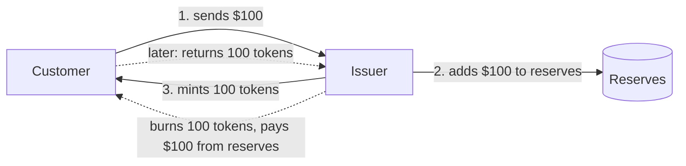

# Fiat-backed stablecoin issuance

> Layer 1 (business). This is the core topic and everything else builds on it.
> Status: first draft, 2026-10-06. Provenance tags are explained in the [README](../README.md#conventions).

## 1. The one-paragraph version

A fiat-backed stablecoin is a token on a blockchain that the issuer promises to redeem for one unit of a fiat currency, usually one US dollar. The promise is credible because the issuer holds **reserves**, meaning cash and short-dated government debt, worth at least as much as all the tokens in circulation. When someone gives the issuer dollars, the issuer **mints** new tokens. When someone returns tokens, the issuer **burns** them and pays out dollars. Issuance is the work of keeping those three numbers in lockstep: **dollars in, tokens out, reserves ≥ supply**. `[industry]`

## 2. Why the business exists

- **For holders:** a dollar that moves at blockchain speed, 24/7, and can be used in on-chain markets. `[industry]`
- **For the issuer:** the reserves earn yield, mostly from T-bills, while the tokens usually pay holders nothing. That interest spread is the main revenue of a stablecoin issuer. Mint and redeem fees are a smaller, secondary line. `[industry]`
- **For a brand that wants its own coin** (an exchange, a payments company, a DeFi protocol): being a regulated issuer is hard. Renting one is easier. This is where Anchorage comes in (section 4).

## 3. The parties

| Party | Role |
|---|---|
| **Issuer** | The legal entity that creates and redeems the token and owns the redemption obligation. It controls the token contract's mint/burn permission. |
| **Brand / program partner** | The company whose name is on the coin and which drives distribution. It can differ from the legal issuer. |
| **Primary-market customer** | An onboarded, KYC'd institution that mints and redeems directly with the issuer. Only these customers deal with the issuer. `[industry]` |
| **Secondary-market holder** | Anyone who buys or sells the token on exchanges or on-chain without touching the issuer. |
| **Reserve custodian / bank** | The place where reserve assets sit. |
| **Attestor / auditor** | An independent firm that checks the reserves publicly. |
| **Regulator** | Supervises the issuer. In the US this follows the GENIUS Act framework (section 7). |

**Primary market vs. secondary market.** The primary market is mint and burn at the issuer. The secondary market is trading of tokens that already exist. The issuer only controls the primary market, but it has to watch both: a token that trades below $1 on the secondary market is a signal about trust in the primary market. Anchorage also uses "secondary market" for **bridging** existing tokens between blockchains (a later topic). `[atlas]`

## 4. How Anchorage fits: issuance as a service

Anchorage Digital Bank, a federally chartered bank, acts as the regulated issuer and operator for stablecoins that partners brand and distribute. Anchorage runs the full lifecycle (mint, burn, reserves reporting, contract controls) on its own custody platform. `[atlas]` for the roster below; `[verify]` for the exact legal-issuer role per coin.

**Coins in the system** (as of 2026-09-02) `[atlas]`:

| Coin | Partner | Notes |
|---|---|---|
| USDtb | Ethena | Issued by Anchorage Digital Bank. |
| USDGO | OSL | OSL Group is a production issuer organization. |
| USDPT | Western Union | |
| USAT | (third party) | Has its own issuer organization, "ADB-NA USAT Issuer", and its own operation types. |
| fUSD, ZLUSD | ? | Appear only in the reserves-reporting pipeline. `[verify]` |
| USDX | none | Internal test coin. |

**Production issuer organizations** `[atlas]`: *ADB Stablecoin Issuer*, *ADB-NA USAT Issuer*, *OSL Group*.

**What Anchorage does *not* do in this flow:** the orchestration layer never touches a bank or a blockchain directly. It tells custody to move fiat and tokens and has each move approved under Anchorage's normal custody controls. `[atlas]`

## 5. The two core flows, as Anchorage runs them

Both flows start from a customer who already holds fiat or tokens in an Anchorage account.

### 5.1 Mint (issue): fiat in, tokens out

1. **Request.** The customer asks to convert, for example "$1M into USDtb", from the client dashboard or the API. `[atlas]`
2. **Hold.** Anchorage freezes $1M in the customer's account so it can't be spent while approvals happen. `[atlas]`
3. **Customer approval.** The customer's own approvers (their *quorum*) review a plain-language summary and sign it. Nothing moves without this. `[atlas]`
4. **Issuer review.** The issuer is supposed to approve each conversion. *Today the code auto-approves this step.* `[atlas]` (open question 1)
5. **Fiat moves first.** The $1M moves from the customer to the issuer. `[atlas]`
6. **Then tokens are minted.** A mint transaction is created and signed with the coin's dedicated minter key, and the tokens land in the customer's wallet. `[atlas]`
7. **Machine approval instead of a second human.** The mint transaction still needs an approval. A tightly constrained automated approver (*autopen*) gives it for routine, within-limits conversions, so a human doesn't have to sign every mint. If autopen declines, a human quorum can still approve. `[atlas]`
8. **Independent checks.** Anchorage re-reads the blockchain to confirm the supply actually changed. A separate watcher (*Botón*) sees every mint on the contract and pages a human if it can't match it to an approved internal record. `[atlas]`

### 5.2 Burn (redeem): tokens in, fiat out

The order is reversed: **tokens are burned on chain first, then fiat is paid.** `[atlas]`

- This protects the issuer: it never pays out dollars for tokens that still exist.
- The cost is that a burn can't be undone. If the payout leg fails after the burn, nothing is rolled back and the operations team completes the payment by hand. `[atlas]`

### 5.3 The ordering rule

| Flow | First | Then | If the second leg fails |
|---|---|---|---|
| Mint | Fiat to issuer | Tokens minted | Mint is not done. The fiat that already moved is **not auto-returned**. `[atlas]` |
| Burn | Tokens burned | Fiat to customer | Ops pay manually. The burn stands. `[atlas]` |

In both directions the issuer is never short: it never has tokens out without dollars in, and never dollars out with tokens still live. The trade-off is that failures land on the customer side and need manual operations follow-up.

## 6. Reserves: what makes the coin worth $1

- **The invariant:** total reserves ≥ total tokens in circulation, across every chain the coin lives on. `[industry]`
- **How Anchorage tracks it:** three times a day (17:00, 20:00 and 23:00 UTC), Anchorage takes a snapshot per coin of *total supply on network*, *total reserves* and the *reserve ratio*. An anomalous ratio posts a Slack alert. The alert does not block anything. `[atlas]`
- **Public reserves data** is served from those snapshots through a reserves API. `[atlas]`
- **Covered coins:** USDGO, USDtb, USDPT, fUSD and ZLUSD. `[atlas]` USAT is not in the list (open question 4).

## 7. Regulatory frame (US)

Under the **GENIUS Act** (signed July 2025) `[industry]`:

- Reserves must back tokens **1:1** with high-quality liquid assets: cash, bank deposits, short-term T-bills, overnight repos backed by T-bills, and government money-market funds.
- The issuer must publish its reserve composition **monthly**, and that report must be examined by an independent accounting firm.
- Payment stablecoin issuers **may not pay interest or yield** to holders.
- Issuers must be permitted entities, such as subsidiaries of insured banks or federally qualified issuers. This fits a federally chartered bank like Anchorage Digital Bank.
- Holders get **priority claim on reserves** if the issuer fails.

`[verify]` the implementing regulations and effective dates. They were still being written at the time of this note's sources.

## 8. Variations to cover in later topics

| Topic | One-liner |
|---|---|
| **Coinductor** (automated conversion) | A customer pre-approves a standing policy, so every fiat deposit is minted automatically, optionally followed by an automatic withdrawal. The withdrawal leg is built but switched off in production. `[atlas]` |
| **Bridging** | Moves a coin between chains by burning it on one and minting it on the other. There's no fiat leg. Anchorage runs its own verifier for this. `[atlas]` |
| **Swap** | Converts issuer A's coin into issuer B's: burn A, move reserves A→B, mint B. `[atlas]` |
| **Manual fiat deposits** | Wires (Fedwire, SWIFT, CHIPS, book transfers) that ops record by hand under quorum. `[atlas]` |
| **Tokenization** | Tokenized deposits and tokenized gold: mint/burn without the fiat conversion. `[atlas]` |
| **Stablecoin rewards** | Monthly reward payouts to eligible holders' organizations. `[atlas]` See open question 3. |
| **Contract controls** | Pause, blocklist, role changes and upgrades on the token contracts. Changes to a coin's config require issuer quorum. `[atlas]` |

## 9. Open questions

1. **Issuer review is hardcoded to "approve".** Is that intended policy, meaning the issuer delegates per-conversion review, or an unfinished feature? `[atlas]` flags it as a high-severity gap.
2. **The legal issuer of each coin.** Is Anchorage Digital Bank the issuer of record for USDGO and USDPT, as it is for USDtb, or does it act as a service provider to a partner issuer?
3. **Rewards vs. the GENIUS yield ban.** How is the stablecoin rewards program structured with respect to the prohibition on issuers paying yield?
4. **Gaps in reserve coverage.** USAT is not in the reserves pipeline, and fUSD and ZLUSD are not in the coin roster. Is reserves reporting for those coins done elsewhere?
5. **Who are the primary-market customers** for each coin: the partner itself, market makers, or exchanges?
6. **Mint failure after fiat moved.** What is the operational procedure for returning a customer's fiat when the mint fails?
7. **Revenue split.** How is reserve yield shared between Anchorage and each brand partner?
