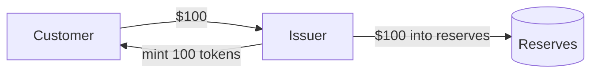

# Fiat-backed stablecoin

**A [stablecoin](stablecoin.md) that the [issuer](issuer.md) promises to redeem one-for-one for a fiat currency. The promise is backed by [reserves](reserves.md) worth at least as much as every token in circulation.** `[industry]`

## How it holds $1

- New dollars come in and tokens are [minted](mint.md).
- Tokens come back, are [burned](burn.md), and dollars go out.
- Because any token can always be swapped for $1 at the issuer, traders keep the [secondary-market](secondary-market.md) price close to $1.

`[industry]`

## How the issuer makes money

Interest on the reserves, mostly from short-dated T-bills, while holders are paid nothing. Mint and redeem fees are a smaller revenue line. `[industry]`

## At Anchorage

Anchorage issues fiat-backed stablecoins for partners: USDtb (Ethena), USDGO (OSL), USDPT (Western Union) and USAT. USDX is an internal test coin. `[atlas]`

## Related

[Reserves](reserves.md) · [Mint](mint.md) · [Burn](burn.md) · [Issuer](issuer.md)
